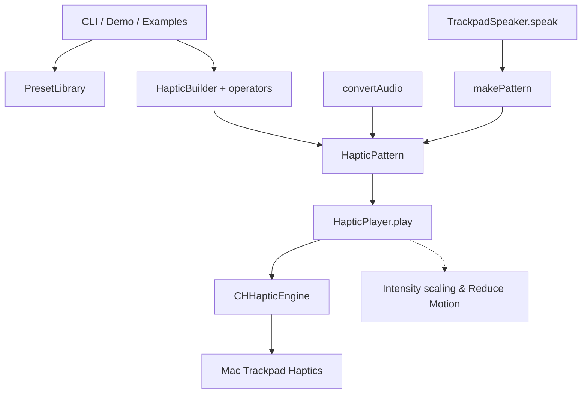

<!-- header:start -->
<div align="center">



<a href="#-quick-start"></a>

<a href="LICENSE"></a>

<a href="https://github.com/ajendras/buzzkit/stargazers"></a>
<a href="https://github.com/ajendras/buzzkit/actions/workflows/ci.yml"></a>

<a href="CONTRIBUTING.md"></a>

**Turns Mac trackpads into programmable speakers and instruments via a fluent Swift haptic composition library**

[✨ Features](#-features) • [⚡ Quick start](#-quick-start) • [🧰 Usage](#-usage) • [🧩 Architecture](#-architecture) • [📍 Roadmap](#-roadmap) • [🤝 Contributing](#-contributing)

</div>
<!-- header:end -->

## ✨ Why BuzzKit?

Community experiments turning the MacBook trackpad’s haptic motor into a speaker have gone viral, yet CoreHaptics remains verbose and low-level. BuzzKit provides a polished, fluent Swift library so developers, sound artists, musicians and tinkerers can rapidly prototype haptic instruments, accessibility tools and playful experiences.

- **Fluent DSL** — compose layered rhythms with `@HapticBuilder`, `loop`, `layer`, `sequence` and `+`/`*` operators
- **Audio → Haptics** — turn short WAV files or synthetic waveforms into accurate `HapticPattern`s via `convertAudio`
- **Live SwiftUI preview** — iterate instantly with the pastel-themed `BuzzKitDemo` pattern editor and real-time sliders
- **Ready-to-play presets & CLI** — `Preset.heartbeat`, `Preset.laser` and the bundled `haptikit` executable for terminal scripts
- **Accessibility-first** — automatic intensity scaling and Reduced Motion compliance built into every API

## 🎬 Demo

<p align="center"></p>

## 🚀 Features

<table>
<tr>
<td align="center" valign="top">
🐝<br>
<b>Fluent DSL</b><br>
Build with @HapticBuilder, loop(), layer() and +/* operators
</td>
<td align="center" valign="top">
🎵<br>
<b>TrackpadSpeaker</b><br>
Turn the haptic motor into a musical instrument with sine/square/triangle/sawtooth
</td>
<td align="center" valign="top">
🔄<br>
<b>Audio → Haptics</b><br>
convertAudio(url:) creates playable patterns from WAV files
</td>
</tr>
<tr>
<td align="center" valign="top">
📚<br>
<b>Preset Library</b><br>
Ready-to-use heartbeat, laser, notification and bassDrum patterns
</td>
<td align="center" valign="top">
🖥️<br>
<b>Live Preview</b><br>
SwiftUI editor with real-time sliders and instant trackpad playback
</td>
<td align="center" valign="top">
🖲️<br>
<b>CLI Tool</b><br>
haptikit play, convert, list-presets and live-repl commands
</td>
</tr>
<tr>
<td align="center" valign="top">
🛡️<br>
<b>Safe Async Wrapper</b><br>
HapticPlayer actor with automatic engine recovery
</td>
<td align="center" valign="top">
♿<br>
<b>Accessibility First</b><br>
Dynamic intensity scaling and Reduced Motion compliance
</td>
<td align="center" valign="top">
✅<br>
<b>Verified Fidelity</b><br>
Unit tests for composition, audio conversion and Codable
</td>
</tr>
</table>

## 📦 Installation

**Requirements**

- macOS 13+
- Swift 5.9+
- Mint (recommended) or Swift Package Manager

```sh
mint install ajendras/buzzkit
```

Add to your `Package.swift` for SwiftPM:

```swift
dependencies: [
    .package(url: "https://github.com/ajendras/buzzkit", from: "1.0.0")
]
```

Run the CLI demo:

```sh
swift run haptikit play heartbeat
```

## ⚡ Quick start

```swift
import BuzzKit

let player = HapticPlayer()

// Play a preset
try await player.play(Preset.heartbeat)

// Build a custom rhythm with the DSL
let rhythm = HapticPattern {
    loop(Preset.bassDrum, times: 3)
    layer(
        HapticPattern.sine(freq: 85, duration: 0.9),
        HapticPattern.noise()
    )
    Preset.notification
}

try await player.play(rhythm)
```

## 🧰 Usage

### Playing presets and composed patterns (from `Examples/Basic.swift`)

```swift
let player = HapticPlayer()

// Preset
try await player.play(Preset.heartbeat)

// DSL with builder
let custom = HapticPattern {
    loop(Preset.bassDrum, times: 3)
    layer(HapticPattern.sine(freq: 85, duration: 0.9, intensity: 0.8), HapticPattern.noise())
    Preset.notification
}
try await player.play(custom)

// Operators for sequencing and repetition
let composed = Preset.laser * 2 + Preset.notification
try await player.play(composed)
```

### Using the trackpad as a musical instrument (from `Examples/TrackpadSine.swift`)

```swift
let speaker = TrackpadSpeaker()

// Play a melody with different waveforms for timbre
speaker.speak(.sine, frequency: 261.6, duration: 0.4)     // C4
speaker.speak(.square, frequency: 392.0, duration: 0.4)   // G4
speaker.speak(.triangle, frequency: 440.0, duration: 0.4) // A4

// Sustained bass
speaker.speak(.sine, frequency: 65, duration: 3.5)
speaker.stop()
```

<details><summary>Advanced: Convert audio file to haptic pattern and save as JSON</summary>

```swift
// Using the CLI
swift run haptikit convert tone.wav --output tone.json

// Or in code
let pattern = try convertAudio(url: URL(fileURLWithPath: "tone.wav"), maxEvents: 90)
let data = try JSONEncoder().encode(pattern)
// pattern is a fully Codable HapticPattern
```
</details>

<details><summary>Advanced: Live REPL and file playback via CLI</summary>

```sh
# List presets
swift run haptikit list-presets

# Interactive experimentation
swift run haptikit live-repl

# Play a saved pattern
swift run haptikit play --file rhythm.json
```
</details>

## 🔧 Configuration

| Option              | Default     | Description |
|---------------------|-------------|-----------|
| `maxEvents`         | 120         | Maximum haptic events produced by `convertAudio(url:maxEvents:)` |
| `device`            | `.trackpad` | Target output for `HapticPlayer.play(_:on:)` (only trackpad currently supported) |

## 🧩 Architecture



`HapticPattern` is the single source of truth—immutable, `Codable` and composable. `HapticBuilder` and the `+`/`*` operators give a readable DSL while `HapticPlayer` safely wraps CoreHaptics with async error recovery. `TrackpadSpeaker` adds a musical abstraction on top, mapping waveforms to distinct sharpness values.

## 📁 Project structure

```text
.
├── Package.swift                          # SwiftPM manifest with library, haptikit CLI, BuzzKitDemo and tests
├── Sources/
│   ├── BuzzKit/
│   │   ├── HapticPattern.swift            # Core struct, Event, factories (pulse, sine, noise), +/* operators, totalDuration
│   │   ├── HapticBuilder.swift            # @resultBuilder + loop(), sequence(), layer() free functions
│   │   ├── HapticPlayer.swift             # Actor, play(_:on:), Device enum, HapticError
│   │   ├── TrackpadSpeaker.swift          # speak(_:frequency:duration:), stop(), Waveform mapping
│   │   ├── AudioConverter.swift           # convertAudio(url:maxEvents:), Waveform enum
│   │   ├── PresetLibrary.swift            # static heartbeat, laser, notification, bassDrum
│   │   └── ...
│   ├── haptikit-cli/
│   │   └── main.swift                     # ArgumentParser commands: play, convert, list-presets, live-repl
│   └── BuzzKitDemo/
│       ├── BuzzKitDemoApp.swift           # SwiftUI app with PatternEditorViewModel
│       └── PatternEditorView.swift        # Pastel UI, sliders, visualiser, live Play button
├── Tests/
│   └── BuzzKitTests/
│       ├── PatternCompositionTests.swift  # DSL, operators, Codable round-trip
│       └── AudioConversionTests.swift     # Synthetic WAV conversion accuracy
└── Examples/
    ├── Basic.swift                        # Preset + DSL + operators demo
    └── TrackpadSine.swift                 # Musical melody with multiple waveforms
```

## 🧪 Testing

```sh
swift test
```

The test suite (`PatternCompositionTests` and `AudioConversionTests`) covers `@HapticBuilder` results, `+` and `*` operator semantics, `Codable` fidelity, factory correctness, audio-to-haptic conversion accuracy using synthetic sine/square waves, event count bounds and accessibility scaling paths.

## 📍 Roadmap
<!-- roadmap:start -->
- [x] **v0.1.0** — first release: Fluent DSL, Audio → Haptics, Live Preview, Effect Library
- [ ] Add spatial haptic support for MacBook Pro 2023+ trackpads with left/right channel mapping
- [ ] Implement real-time microphone → haptic streaming with low-latency FFT analysis
- [ ] Publish a SwiftUI HapticButton component library with built-in press feedback variants
- [ ] Add MIDI file import that maps notes to distinct haptic timbres
- [ ] Create an AUv3 Audio Unit that routes synth output to the trackpad motor
- [ ] Support Linux haptic devices (Steam Deck, Framework laptop) via a separate backend
- [ ] Add waveform visualiser using Swift Charts that renders live haptic envelopes
- [ ] Provide official Homebrew formula and updated mint install instructions
- [ ] Expose a REST endpoint (via local server) so non-Swift apps can trigger patterns
- [ ] Implement pattern recorder that captures manual trackpad taps into editable HapticPattern
- [ ] Add accessibility audit mode that suggests improvements for reduced-motion users

> 🤖 This roadmap is worked through continuously — ideas and PRs welcome!
<!-- roadmap:end -->

## 🤝 Contributing

We’d love your help making BuzzKit even more delightful! Please read [CONTRIBUTING.md](https://github.com/ajendras/buzzkit/blob/main/CONTRIBUTING.md) and follow our [Code of Conduct](https://github.com/ajendras/buzzkit/blob/main/CODE_OF_CONDUCT.md). Good-first-issue PRs are especially welcome—check the label and open a PR.

## 📄 License

This project is licensed under the MIT License. See [LICENSE](LICENSE) for details.

<!-- footer:start -->
<div align="center">

### ⭐ Star history

<a href="https://star-history.com/#ajendras/buzzkit&Date"></a>

If **BuzzKit** saves you time, a ⭐ helps others find it.

Made with ❤️ by [Ajendra](https://ajendra.info)


</div>
<!-- footer:end -->
